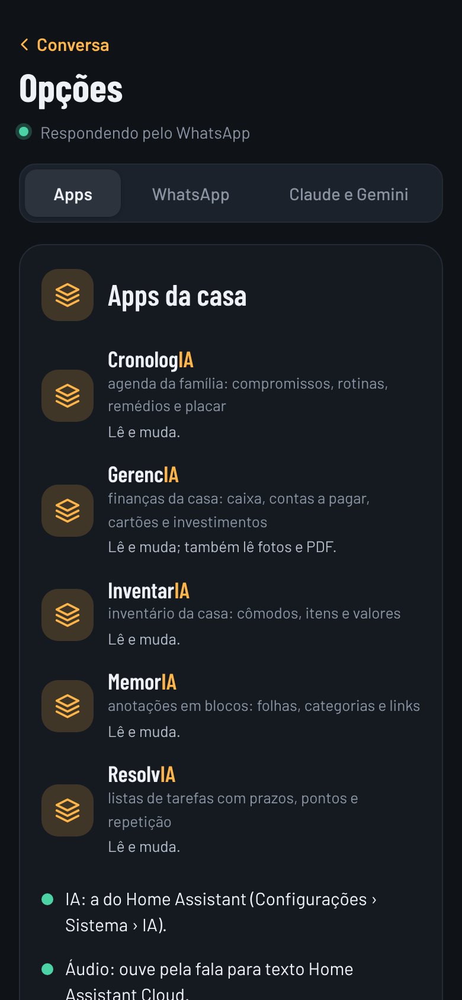
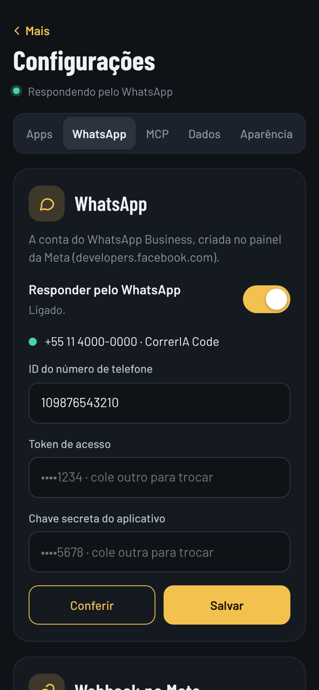
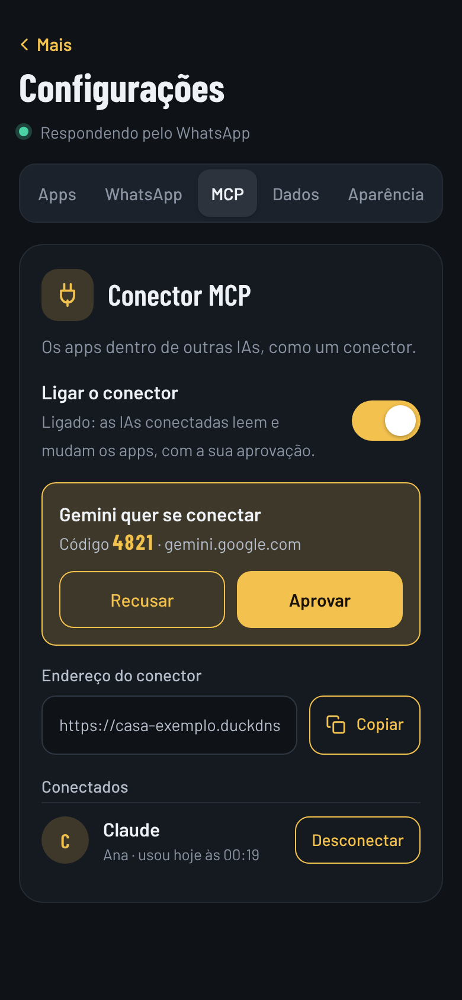

# CorrerIA para Home Assistant


Um App do Home Assistant que junta os apps no **WhatsApp** (um contato da CorrerIA Code, pela API oficial do WhatsApp Business), no **Claude** e no **Gemini** (como um conector MCP). Pergunte ("quanto gastei com mercado este mês?", "o que tem na agenda amanhã?") e peça ("lança 45 de mercado", "marca a tarefa do lixo como feita"): a IA usa as ferramentas de cada app, e as mudanças só acontecem com a sua confirmação.

<p align="center">
  
  
  
  
</p>

## Instalação

1. No Home Assistant: **Configurações → Aplicativos → Loja de aplicativos**.
2. No menu **⋮ → Repositórios**, adicione:
   ```
   https://github.com/diegozapella63/CorrerIA-ha
   ```
3. Procure **CorrerIA** na loja, toque em **Instalar** e depois em **Iniciar**.
4. Ative **Mostrar na barra lateral** e siga a aba **Documentação** (a conta na Meta, o Duck DNS, a porta 8443 no roteador e o conector do Claude e do Gemini).
5. Em cada app da família, ligue **Mais › Configurações › Integrações › CorrerIA**.

[](https://my.home-assistant.io/redirect/supervisor_add_addon_repository/?repository_url=https%3A%2F%2Fgithub.com%2Fdiegozapella63%2FCorrerIA-ha)

## Os apps da família

| App | O que é |
|---|---|
| [GerencIA](https://github.com/diegozapella63/gerencia-ha) | finanças: caixa, cartões, investimentos |
| [CronologIA](https://github.com/diegozapella63/cronologia-ha) | agenda da família, remédios, rotinas e placar |
| [ResolvIA](https://github.com/diegozapella63/resolvia-ha) | listas de tarefas com prazos, pontos e repetição |
| [InventarIA](https://github.com/diegozapella63/inventario-ha) | inventário da casa: cômodos, itens e valores |
| [MemorIA](https://github.com/diegozapella63/memoria-ha) | cadernos de anotação que abrem na hora certa |

Feito por **CorrerIA Code** · desenvolvimento de softwares.
