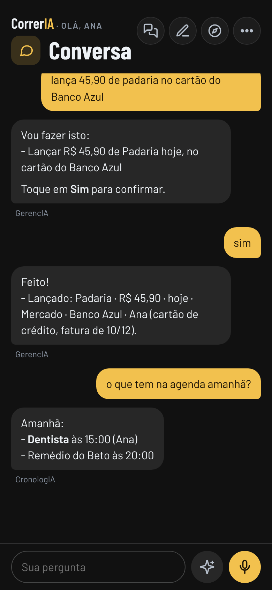
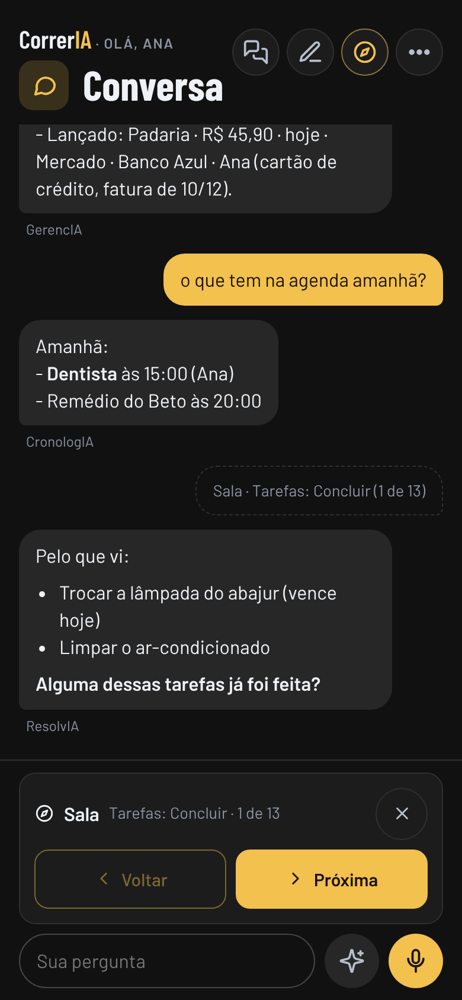
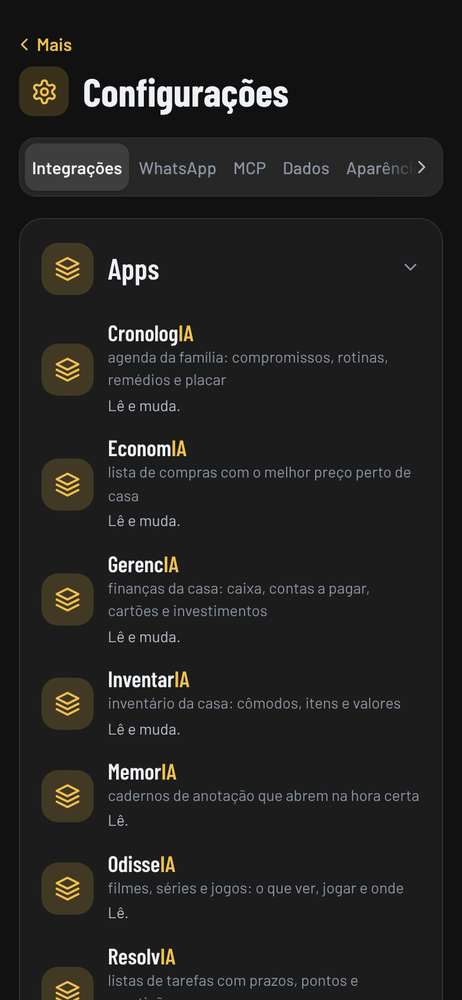
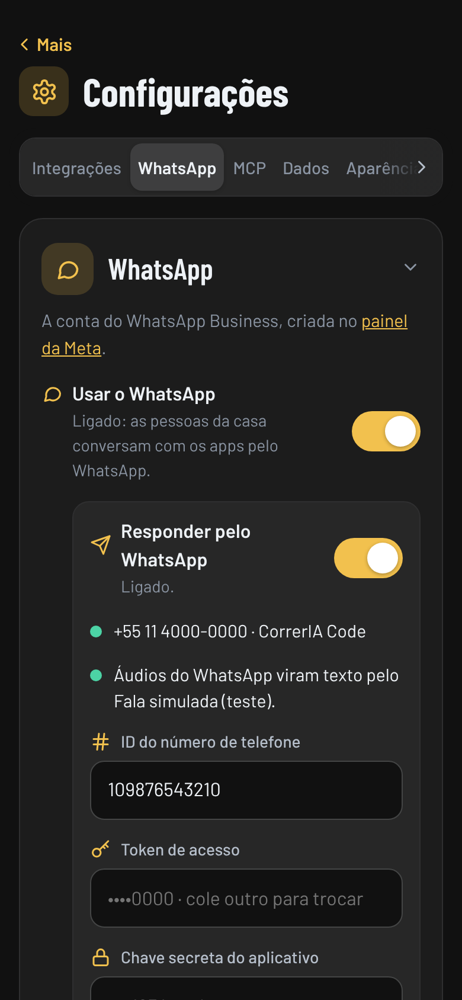
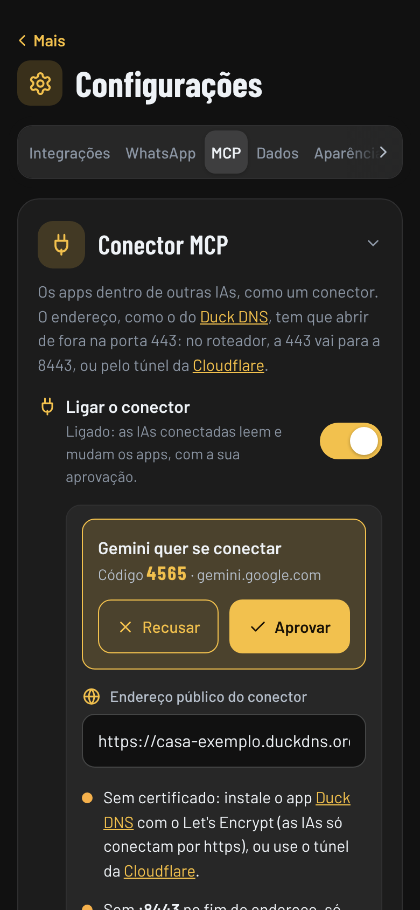

# CorrerIA para Home Assistant


Um App do Home Assistant que junta os apps da família num lugar só: a **Conversa** da própria tela, o **WhatsApp** (um contato da CorrerIA Code, pela API oficial do WhatsApp Business) e outras IAs, como o Claude e o Gemini, por um **conector MCP**. Pergunte ("quanto gastei com mercado este mês?", "o que tem na agenda amanhã?") e peça ("lança 45 de mercado", "marca a tarefa do lixo como feita"): a IA usa as ferramentas de cada app, e as mudanças só acontecem com o seu **Sim**.

<p align="center">
  
  
  
  
  
</p>

## O que tem

- **Conversa**: perguntas e pedidos para todos os apps de uma vez, com fotos e PDFs (o app do assunto lê), o **Falar** e as perguntas prontas. Cada mudança mostra o que vai fazer e espera o **Sim**; o **Desfazer** volta atrás.
- **Rondas**: um roteiro pronto pelos apps, **uma pergunta de cada vez**, com o que cada app já tem antes da pergunta. A **Ronda da casa** passa cômodo por cômodo (tarefas, rotinas, manutenções, itens, consumíveis, compras e o que ficou ligado); há também as do dia, da noite, da semana, do mês, das compras, da chegada das compras, das finanças, do patrimônio, das anotações, do lazer e da viagem. Dá para mudar qualquer uma, criar as suas e receber o aviso no celular quando uma ficar atrasada.
- **WhatsApp**: as pessoas da casa conversam com os apps pelo WhatsApp, também por áudio e foto.
- **Claude, Gemini e outras IAs**: o conector MCP, com login aprovado no painel do Home Assistant.
- **A casa**: "apaga a luz da sala", "o que ficou ligado?" vão para o Assist do Home Assistant.
- **Memória da IA**: uma memória só, da casa, compartilhada por todos os apps.
- **Tela cheia**: num monitor, o painel da CronologIA com a Conversa ao lado.

## Instalação

1. No Home Assistant: **Configurações → Aplicativos → Loja de aplicativos**.
2. No menu **⋮ → Repositórios**, adicione:
   ```
   https://github.com/diegozapella63/CorrerIA-ha
   ```
3. Procure **CorrerIA** na loja, toque em **Instalar** e depois em **Iniciar**.
4. Ative **Mostrar na barra lateral** e siga a aba **Documentação** (a conta na Meta, o Duck DNS, a porta 8443 no roteador e o conector MCP).
5. Em cada app da família, ligue **Mais › Configurações › Integrações › CorrerIA**.

[](https://my.home-assistant.io/redirect/supervisor_add_addon_repository/?repository_url=https%3A%2F%2Fgithub.com%2Fdiegozapella63%2FCorrerIA-ha)

## Os apps da família

| App | O que é |
|---|---|
| [CronologIA](https://github.com/diegozapella63/cronologia-ha) | agenda da família, remédios, rotinas e placar |
| [ResolvIA](https://github.com/diegozapella63/resolvia-ha) | listas de tarefas com prazos, pontos e repetição |
| [GerencIA](https://github.com/diegozapella63/gerencia-ha) | finanças: caixa, cartões, investimentos |
| [InventarIA](https://github.com/diegozapella63/inventario-ha) | inventário da casa: cômodos, itens e valores |
| [EconomIA](https://github.com/diegozapella63/economia-ha) | lista de compras com o melhor preço perto de casa |
| [MemorIA](https://github.com/diegozapella63/memoria-ha) | cadernos de anotação que abrem na hora certa |
| [OdisseIA](https://github.com/diegozapella63/OdisseIA) | filmes, séries e jogos: o que ver, jogar e onde |

## Desenvolvimento

Rodar no computador, os testes e as capturas deste README (`python3 tools/prints_readme.py`, com uma casa inventada): veja o [AGENTS.md](AGENTS.md) e o [tests/README.md](tests/README.md).

Feito por **CorrerIA Code** · desenvolvimento de softwares.
